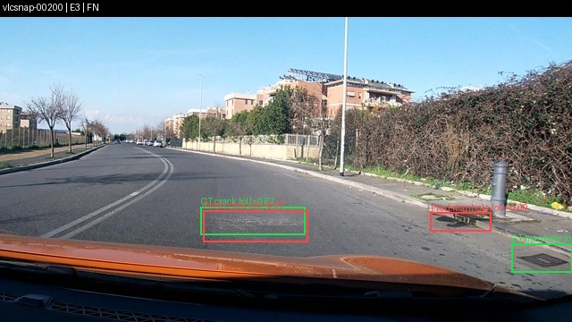
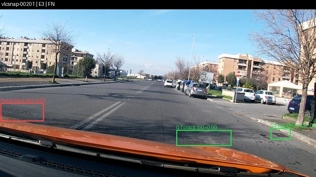
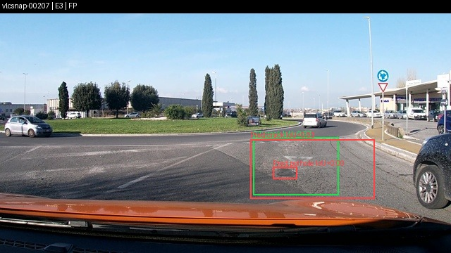
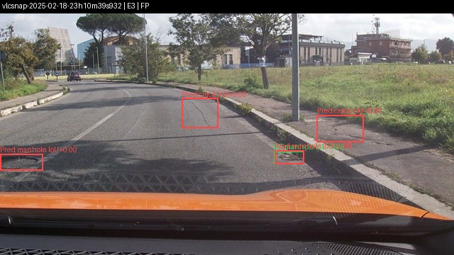
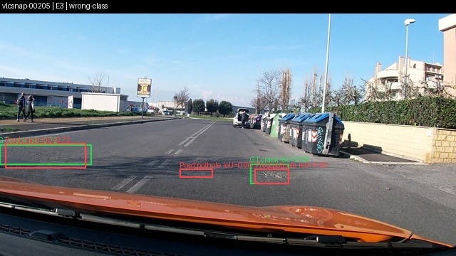
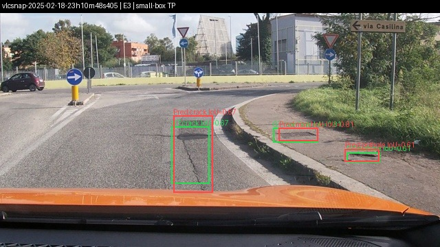
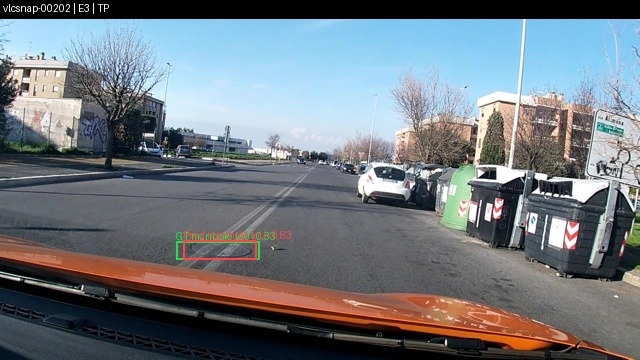
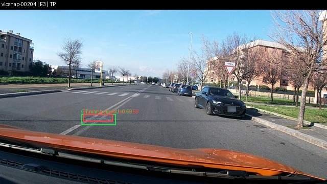

# Lab Day 10 — Qwen3-VL Road Damage

**Họ tên:** LÊ NGUYỄN TRÂM ANH

**Dataset version:** `d10-21e4070301`

**Thiết bị:** Kaggle Tesla T4 16 GB

**Run chính thức:** Kaggle Version 7, `scriptVersionId=358548947`

Môi trường notebook: Python 3.13.15, CUDA 12.8, PyTorch 2.11.0+cu128, Transformers 5.19.0, PEFT 0.21.2, TRL 1.9.2 và bitsandbytes 0.50.2. Các số dưới đây lấy trực tiếp từ `report/evidence/*.json` do `scripts/score.py` sinh trên test split 311 ảnh; không dùng validation thay cho test.

## Bảng tổng hợp E0–E4

| Mã | Thiết lập | Trainable params | VRAM GB | Phút | Parse | F1 test | CI95 | FP/ảnh | pothole | crack | manhole |
|---|---|---:|---:|---:|---:|---:|---|---:|---:|---:|---:|
| E0 | Zero-shot | 0 | — | — | 0.936 | 0.104 | 0.077–0.135 | 1.042 | 0.134 | 0.038 | 0.246 |
| E1 | LoRA LLM | 33,030,144 | 8.803 | 52.855 | 0.997 | 0.258 | 0.222–0.300 | 1.254 | 0.194 | 0.177 | 0.522 |
| E2 | E1 + projector | 142,135,296 | 10.296 | 53.357 | 1.000 | 0.330 | 0.291–0.371 | 1.055 | 0.205 | 0.265 | 0.564 |
| E3 | E2 + LoRA ViT | 148,426,752 | 10.471 | 61.973 | 1.000 | **0.433** | 0.390–0.475 | **0.929** | **0.297** | **0.374** | **0.658** |
| E4 10% | E3, 142 ảnh | 148,426,752 | 10.217 | 61.963 | 1.000 | 0.257 | 0.223–0.292 | 1.862 | 0.150 | 0.186 | 0.564 |
| E4 100% | E3, 1.422 ảnh | 148,426,752 | 10.471 | 61.973 | 1.000 | 0.433 | 0.390–0.475 | 0.929 | 0.297 | 0.374 | 0.658 |

E1 hơn E0 `0.1533` F1 và có parse-valid rate `0.9968`, vượt hai cổng bắt buộc. E3 có validation/test tốt nhất trong các setup SFT. Mọi evidence đều có `missing_predictions = 0`, `split = test` và cùng dataset version.

## Trả lời 10 câu hỏi

### Câu 1 — Kiến trúc và tham số được cập nhật

Kiểm kê theo số tham số logic trước NF4: toàn model `4,437,815,808`, LLM `4,022,468,096`, ViT `306,242,560` và projector `109,105,152`. Projector là một phần của vision tower, nên vision tower đầy đủ có `415,347,712` tham số.

E1 mở LoRA trên 252 module LLM và có 33,030,144 tham số trainable. E2 giữ 252 module đó và mở projector float32, đạt 142,135,296. E3 thêm LoRA ViT, tổng 348 module LoRA và 148,426,752 tham số trainable. Tôi không dùng `numel()` của tensor NF4 đã đóng gói để suy ra kích thước model.

### Câu 2 — E0 và hai lỗi phổ biến

E0 đạt parse-valid `0.9357`, precision `0.1337`, recall `0.0858`, F1 `0.1045`. Hai lỗi chính là bỏ sót, thể hiện qua 533 false negative, và box/lớp không ghép được với GT, tạo 324 false positive. Crack yếu nhất với F1 `0.0385`.

Một raw completion được giữ trong output prediction minh họa đúng định dạng:

```json
[{"label":"crack","bbox_2d":[355,653,538,750]},{"label":"manhole","bbox_2d":[753,661,859,717]}]
```

Raw output E0 theo từng ảnh nằm trong `work/e0_test.jsonl` của Kaggle Output Version 7; `work/` không được commit theo quy định.

### Câu 3 — Thang tọa độ 0–1000

Prediction dùng `[x1,y1,x2,y2]` trên thang tương đối 0–1000. Scorer đưa GT YOLO sang cùng thang trước khi ghép box. Nếu đọc các số đó như pixel 640×360, box bị co/phóng khác nhau theo hai trục; nếu đọc pixel như 0–1000, vị trí bị kéo lệch. Cả hai làm IoU giảm và nhiều cặp đúng rơi dưới ngưỡng 0,5. Pipeline kiểm chứng bằng phép đổi hai chiều YOLO → 0–1000 → pixel, kiểm tra box biên và dùng thống nhất `coord = norm1000` trong toàn bộ evidence chính thức.

### Câu 4 — Mask loss

Loss chỉ áp dụng cho JSON assistant và token kết thúc. Prompt, image placeholder và vision tokens mang nhãn `-100`. Gradient vì thế tập trung vào định dạng, lớp và tọa độ. Nếu tính loss trên toàn đầu vào, phần prompt cố định dễ dự đoán sẽ lấn tín hiệu grounding; loss có thể giảm nhưng box không tốt hơn.

### Câu 5 — Lượng tử hóa và projector

LLM base dùng NF4. Preflight xác nhận không có `bitsandbytes.Linear4bit` trong vision tower, `visual.merger`, ba `visual.deepstack_merger_list` hoặc `lm_head`. Projector 109,105,152 tham số được train float32 trong E2/E3; ViT và `lm_head` giữ fp16. LoRA trainable được nâng float32 để tránh gradient fp16 trước `GradScaler.unscale_`. Projector được lưu riêng vì adapter PEFT không tự chứa toàn khối này.

### Câu 6 — Chia tập theo session

Frame liên tiếp của một phiên gần như trùng cảnh. Chia ngẫu nhiên sẽ đưa frame gần giống nhau vào train và test, gây rò rỉ. Dataset `d10-21e4070301` chia theo session: train 1.422 ảnh (1.074 pothole, 1.750 crack, 691 manhole), val 276 (66, 470, 103), test 311 (121, 299, 163). Không có session giao nhau.

### Câu 7 — So sánh E1, E2 và E3

F1 tăng từ `0.2578` ở E1 lên `0.3300` ở E2 và `0.4331` ở E3. E2 hơn E1 `0.0721`; E3 hơn E1 `0.1752`. E3 đồng thời giảm FP/ảnh từ `1.254` xuống `0.929`, với chi phí thêm khoảng 1.675 GB VRAM và 9.12 phút so với E1. CI95 của E2 là `0.291–0.371`, còn E3 là `0.390–0.475`; hai khoảng không chồng nhau. Với giới hạn T4 16 GB, E3 là lựa chọn đáng tiền nhất vì đạt F1 và F1 từng lớp cao nhất, giảm FP rõ rệt và vẫn chỉ dùng 10.471 GB VRAM.

### Câu 8 — Độ bất định trên 311 ảnh

CI95 E0–E3 lần lượt là `0.077–0.135`, `0.222–0.300`, `0.291–0.371` và `0.390–0.475`. Khoảng tin cậy thể hiện trực tiếp độ bất định trên 311 ảnh: các chênh lệch nhỏ cần được diễn giải thận trọng, trong khi mức tăng của E3 đủ lớn để toàn bộ CI95 của E3 nằm trên E2 và E1. Vì vậy kết luận E3 tốt nhất được hỗ trợ đồng thời bởi F1 điểm, CI95, FP/ảnh và kết quả theo từng lớp.

### Câu 9 — Lỗi theo lớp và hình minh họa

Ở E3, manhole đạt F1 `0.6575`, crack `0.3740`, pothole `0.2973`. Crack có nhiều mẫu train nhất nhưng hình dạng mảnh, kéo dài khiến IoU nhạy với sai lệch tọa độ. Pothole có recall `0.2727`, cho thấy còn nhiều bỏ sót. Manhole đều hình hơn nên precision `0.7442`, recall `0.5890`.

Các hình dưới đây được dựng từ ảnh test gốc và `work/e3_test.jsonl` của Kaggle Output Version 7. Box GT màu xanh lá, prediction E3 màu đỏ; cả hai được đổi từ thang 0–1000 về pixel 640×360 trước khi vẽ. Tiêu đề ghi image ID, model và loại lỗi; nhãn cạnh box ghi lớp và IoU tốt nhất với box cùng lớp.

| False negative | False negative |
|---|---|
|  |  |

| False positive | False positive |
|---|---|
|  |  |

| Sai lớp | Box nhỏ, dự đoán đúng |
|---|---|
|  |  |

| True positive | True positive |
|---|---|
|  |  |

Ảnh và prediction dùng để chọn ví dụ được lấy đúng theo `image_id`; không có ảnh tổng hợp hay box tự đặt.

### Câu 10 — E4: kích thước dữ liệu

E4 chỉ đổi số ảnh train: 10% dùng subset cố định 142 ảnh, 100% dùng 1.422 ảnh; setup E3, seed, rank, LR, prompt, tọa độ và 300 bước giữ nguyên. F1 tăng từ `0.2566` (CI95 `0.2232–0.2917`) lên `0.4331` (CI95 `0.3899–0.4751`), chênh `0.1765`. Hai CI95 tách biệt, đồng thời FP/ảnh giảm từ `1.862` xuống `0.929`. Kết quả cho thấy quy mô dữ liệu là biến có tác động lớn và nhất quán đến khả năng tổng quát hóa.

## Nhật ký tài nguyên

| Run | Trainable params | Peak VRAM GB | Train minutes |
|---|---:|---:|---:|
| E1 | 33,030,144 | 8.803396 | 52.854550 |
| E2 | 142,135,296 | 10.295559 | 53.356561 |
| E3 | 148,426,752 | 10.470715 | 61.972960 |
| E4 10% | 148,426,752 | 10.217309 | 61.962673 |

Các giá trị khớp trực tiếp trường `meta` trong evidence.

## Tính tái lập

Sáu evidence chính thức trong `report/evidence/` được trích nguyên giá trị từ Kaggle Output Version 7. E0–E4 đều dùng test split 311 ảnh, `missing_predictions = 0` và dataset version `d10-21e4070301`. Repository chỉ lưu mã nguồn, evidence nhỏ, hình minh họa và báo cáo; dataset, prediction trung gian, checkpoint, token và trọng số không được commit.
