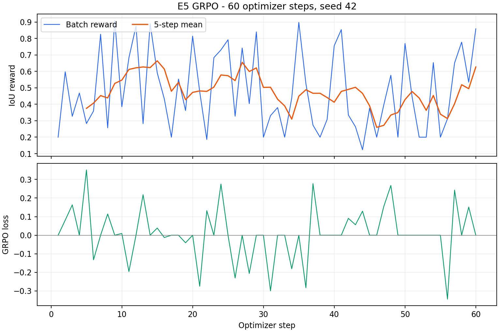

# Lab Day 10 — Qwen3-VL Road Damage

**Họ tên:** LÊ NGUYỄN TRÂM ANH
**Dataset version:** `d10-21e4070301` — train/val/test: **1.422 / 276 / 311 ảnh**.
**Thiết bị:** Kaggle Tesla T4 16 GiB; tiến trình E5 dùng GPU 0 trong máy T4 x2.

## Nguồn kết quả và cách đọc báo cáo

E0–E4 và tám ảnh minh họa thuộc [Kaggle Version 7](https://www.kaggle.com/code/nguyentramanhle/lab-day-10-qwen3-vl-full-100-bonus-e5/output?scriptVersionId=358548947). Bốn evidence bonus được tải nguyên gốc từ [Version 14](https://www.kaggle.com/code/nguyentramanhle/lab-day-10-qwen3-vl-full-100-bonus-e5/output?scriptVersionId=359982787), trạng thái **Successfully ran in 2454.7s** (40 phút 55 giây). Bảng dưới đây dùng test split; validation phục vụ chọn setup, không thay cho kết quả test.

Baseline E3 đi kèm snapshot đầu vào của E5 có F1 **0.4372** và được lưu riêng tại `report/bonus/e3_sft_baseline.json`. E3 Version 7 có F1 **0.4331**. Phần bonus dùng đúng baseline của snapshot E5 để tính chênh lệch và paired CI; phần E0–E4 giữ nguyên nguồn Version 7. `report/bonus/provenance.json` ghi version, nguồn và SHA-256 của các file đã tải.

Môi trường E5 ghi trong run metadata: Python 3.13.15, CUDA 12.8, PyTorch 2.11.0+cu128, Transformers 5.19.0, PEFT 0.21.2, TRL 1.9.2, bitsandbytes 0.50.2 và Accelerate 1.15.0.

## Bảng tổng hợp E0–E4

| Run | Thiết lập | Trainable params | VRAM GiB | Phút train | Parse | F1 test | CI95 | FP/ảnh | pothole | crack | manhole |
|---|---|---:|---:|---:|---:|---:|---|---:|---:|---:|---:|
| E0 | Zero-shot | 0 | — | — | 0.9357 | **0.1045** | [0.0770; 0.1348] | 1.0418 | 0.1342 | 0.0385 | 0.2458 |
| E1 | LoRA LLM | 33,030,144 | 8.803 | 52.855 | 0.9968 | **0.2578** | [0.2217; 0.2996] | 1.2540 | 0.1939 | 0.1766 | 0.5217 |
| E2 | E1 + projector | 142,135,296 | 10.296 | 53.357 | 1.0000 | **0.3300** | [0.2911; 0.3705] | 1.0547 | 0.2047 | 0.2651 | 0.5643 |
| E3 | E2 + LoRA ViT | 148,426,752 | 10.471 | 61.973 | 1.0000 | **0.4331** | [0.3899; 0.4751] | 0.9293 | 0.2973 | 0.3740 | 0.6575 |
| E4_DATA_SIZE_0.1 | E3, 142 ảnh | 148,426,752 | 10.217 | 61.963 | 1.0000 | **0.2566** | [0.2232; 0.2917] | 1.8617 | 0.1500 | 0.1855 | 0.5643 |
| E4_DATA_SIZE_1.0 | E3, 1.422 ảnh | 148,426,752 | 10.471 | 61.973 | 1.0000 | **0.4331** | [0.3899; 0.4751] | 0.9293 | 0.2973 | 0.3740 | 0.6575 |

E1 tăng **0.1533 F1** so với E0, vượt cổng +0,10; parse-valid rate **0.9968** vượt 0,95. Cả sáu evidence đều có `missing_predictions=0`, `split=test`, `coord=norm1000` và cùng dataset version.

## Trả lời 10 câu hỏi

### Câu 1 — Kiến trúc và các tham số được cập nhật

Theo kích thước logic trước khi đóng gói NF4, toàn model có **4.437.815.808** tham số: LLM **4.022.468.096**, các khối ViT ngoài projector **306.242.560**, projector **109.105.152**. Projector gồm `visual.merger` và ba `visual.deepstack_merger_list`, là tập con của vision tower; vision tower đầy đủ có **415.347.712** tham số. Cộng projector thêm lần nữa vào vision tower sẽ đếm trùng.

E1 gắn LoRA rank 16, alpha 32 lên **252** module LLM, cập nhật **33.030.144** tham số. E2 mở thêm toàn projector, đạt **142.135.296**, tăng đúng **109.105.152** so với E1. E3 thêm LoRA vào 96 module ViT, đạt **348** module LoRA và **148.426.752** tham số trainable. Mã `inspect_architecture` dùng `in_features × out_features` cho Linear4bit, thay vì coi `numel()` của tensor NF4 đóng gói là số tham số logic.

### Câu 2 — E0 và hai kiểu lỗi phổ biến

E0 có precision **0.1337**, recall **0.0858**, F1 **0.1045**, parse-valid **0.9357**. Có **533 FN** và **324 FP**: model bỏ sót hư hại, đồng thời tạo box hoặc lớp không ghép được với GT ở IoU ≥ 0,5. Crack đạt F1 **0.0385**, cho thấy mô tả zero-shot chưa đủ để định vị ổn định lớp này.

Raw completion E0 đã trích từ prediction Version 7:

```json
[{"label":"crack","bbox_2d":[355,653,538,750]},{"label":"manhole","bbox_2d":[753,661,859,717]}]
```

Chuỗi trên hợp lệ về định dạng, nhưng JSON hợp lệ không bảo đảm box đúng. Grounding còn đòi hỏi đúng lớp và đủ IoU với GT. Prediction thô của lần chạy nằm trong `labrepo/work/e0_test.jsonl` ở output Version 7.

### Câu 3 — Sai thang tọa độ làm F1 thay đổi thế nào?

Tôi chấm lại **cùng 311 prediction E3 Version 7** bằng scorer gốc trên CPU: đúng `norm1000` cho F1 **0.433064**, cố tình đọc thành `pixel` cho F1 **0.000000**. Không chạy lại mô hình. File `report/analysis/coordinate_scale_check.json` lưu hai kết quả và hash của prediction/split đã dùng.

Với ảnh 640×360, pixel đúng của box 0–1000 là `x_pixel=x_norm×640/1000`, `y_pixel=y_norm×360/1000`. Đọc trực tiếp số norm1000 như pixel khiến scorer lại nhân x với 1000/640 và y với 1000/360. Hai hệ số khác nhau làm lệch cả vị trí lẫn tỷ lệ box, nên cặp đúng dễ rơi dưới IoU 0,5. Pipeline đổi YOLO → norm1000, sắp theo `(y1,x1)` và chỉ đổi về pixel lúc vẽ.

### Câu 4 — Mask loss và token ảnh

`encode_example` dựng riêng chuỗi prompt và chuỗi đầy đủ prompt + assistant, kiểm tra prompt là tiền tố rồi đặt nhãn tiền tố thành **−100**. Padding cũng là −100; chỉ JSON assistant và token kết thúc tham gia cross-entropy. Token ảnh thuộc phần prompt nên được mask cùng tiền tố; kiểm tra số vision token mong đợi cho ảnh 640×360 là **220** theo cấu hình processor của lab.

Mask tại ranh giới token sau chat template giúp không lệch vị trí do image placeholder được mở rộng thành nhiều vision token. Nếu tính loss trên toàn chuỗi, prompt cố định dễ dự đoán có thể chi phối loss, làm loss giảm mà chất lượng lớp/tọa độ không cải thiện tương ứng. Collator pad các chuỗi văn bản nhưng nối `pixel_values` và `image_grid_thw` theo chiều 0.

### Câu 5 — NF4, float32 và checkpoint projector

LLM base dùng NF4; skip list có cả `visual`/`model.visual` và `lm_head`/`model.lm_head` để phù hợp tên module thực. Preflight kiểm tra vision tower và projector không chứa Linear4bit, đồng thời đối chiếu số tham số logic.

E2/E3 train đầy đủ projector **109,1 triệu** tham số ở float32; ViT base và lm_head giữ fp16. LoRA trainable được nâng float32 để tránh gradient fp16 ở bước `GradScaler.unscale_`. Nếu quantize cả vision tower, projector cũng có nguy cơ trở thành trọng số NF4 đóng gói, không còn là tập tham số float32 để cập nhật đầy đủ như setup E2/E3. Adapter PEFT và projector được lưu riêng; inference nạp lại cả hai.

### Câu 6 — Vì sao chia tập theo session?

Các ảnh là frame video; hai frame gần nhau trong một session có thể gần như trùng cảnh, ánh sáng và vị trí hư hại. Chia ngẫu nhiên theo ảnh có thể đưa cùng cảnh vào train và test, làm đánh giá phản ánh ghi nhớ cảnh. Split của lab gán cả session vào một tập.

Dataset `d10-21e4070301` có train **1.422 ảnh** với box pothole/crack/manhole **1.074/1.750/691**, val **276 ảnh** với **66/470/103**, test **311 ảnh** với **121/299/163**. Phân bố lớp không đều giữa các session là lý do cần báo cáo F1 từng lớp và CI, bên cạnh micro-F1. Notebook E5 xác nhận lại dataset version, số ảnh và đường dẫn ảnh trước khi load model.

### Câu 7 — Setup nào có hiệu quả và chi phí tốt nhất?

E1/E2/E3 đạt F1 **0.2578/0.3300/0.4331**. E2 hơn E1 **0.0721**; E3 hơn E1 **0.1752**. Projector giúp căn chỉnh đặc trưng ảnh với token tọa độ; LoRA ViT ở E3 cho phép điều chỉnh thêm biểu diễn thị giác cho hư hại đường.

E3 giảm FP/ảnh từ **1.2540** của E1 xuống **0.9293**. Chi phí tăng **1.667 GiB** và **9.12 phút**. Với T4 16 GiB, E3 dùng **10.471 GiB** cấp phát đỉnh, có F1 cao nhất ở cả ba lớp nên được chọn làm setup SFT tốt nhất.

### Câu 8 — Đọc CI95 trên 311 ảnh

Scorer bootstrap theo ảnh cho CI95 E0 **[0.0770; 0.1348]**, E1 **[0.2217; 0.2996]**, E2 **[0.2911; 0.3705]**, E3 **[0.3899; 0.4751]**. CI E3 nằm trên CI E2 và E1, hỗ trợ kết luận xếp hạng cùng với F1 điểm và FP/ảnh. Các CI riêng không thay thế trực tiếp CI của chênh lệch; không suy diễn mức tăng nhỏ chỉ từ việc hai CI chồng nhau hay không.

Phần E5 có thêm **paired bootstrap 2.000 lần**, seed 42: mỗi lần lấy mẫu lại cùng các image ID cho cả baseline và E5, rồi tính chênh lệch micro-F1. CI95 chênh lệch **[0.0040; 0.0254]** không chứa 0. Các CI này mô tả bất định do lấy mẫu 311 ảnh test; chúng chưa đo biến thiên giữa nhiều seed huấn luyện.

### Câu 9 — Diện tích box, lỗi từng lớp và ảnh minh họa

| Lớp | Box GT | Diện tích trung vị (% ảnh) | Box < 0,5% ảnh | TP | FP | FN | F1 E3 |
|---|---:|---:|---:|---:|---:|---:|---:|
| pothole | 121 | 0.4193 | 68 | 33 | 68 | 88 | 0.2973 |
| crack | 299 | 1.9813 | 15 | 112 | 188 | 187 | 0.3740 |
| manhole | 163 | 0.6688 | 64 | 96 | 33 | 67 | 0.6575 |

Thống kê diện tích dùng `width_yolo×height_yolo×100` trên GT test và được lưu trong `report/analysis/test_box_areas.json`. Pothole có **68/121** box nhỏ hơn 0,5% ảnh, phù hợp với việc cần định vị chính xác đối tượng nhỏ. Crack có box bao trung vị lớn hơn nhưng hình dạng mảnh, kéo dài, nên dịch đường biên vẫn làm IoU thay đổi mạnh. Manhole có nhiều box nhỏ mà F1 vẫn cao nhất; diện tích không giải thích một mình kết quả, hình dạng và độ phân biệt lớp cũng có vai trò. Đây là diễn giải từ thống kê, không phải thí nghiệm can thiệp riêng vào kích thước.

Tám ảnh test dưới đây dùng prediction **E3 Version 7**, khớp bảng E0–E4. GT màu xanh lá, prediction màu đỏ; cả hai đổi từ norm1000 về pixel trước khi vẽ. Chú thích ghi image ID, model, lớp, IoU tốt nhất cùng lớp và loại lỗi.

| False negative | False negative |
|---|---|
|  |  |

| False positive | False positive |
|---|---|
|  |  |

| Sai lớp | Box nhỏ, dự đoán đúng |
|---|---|
|  |  |

| True positive | True positive |
|---|---|
|  |  |

Ảnh gốc và prediction được đối chiếu bằng image ID; không dùng ảnh sinh hoặc box tự đặt.

### Câu 10 — E4: chỉ thay đổi kích thước dữ liệu

Nhánh 10% dùng subset cố định **142 ảnh**; nhánh 100% dùng **1.422 ảnh**, tái sử dụng kết quả setup E3. Seed 42, rank, LR, prompt, thang tọa độ, số bước 300 và setup E3 giữ nguyên.

F1 lần lượt **0.2566** với CI95 **[0.2232; 0.2917]** và **0.4331** với CI95 **[0.3899; 0.4751]**. Mức tăng là **0.1765**, đồng thời FP/ảnh giảm từ **1.8617** xuống **0.9293**. Hai CI riêng tách biệt cho thấy lợi ích rõ trong lần chạy này. Việc giữ nguyên số bước nghĩa là nhánh 10% lặp lại mỗi ảnh nhiều hơn; thêm dữ liệu vẫn cải thiện khả năng tổng quát hóa trên test.

## Bonus E5 — GRPO với reward IoU

### Reward và các cổng kiểm tra

`student/e5.py` dùng parser của scorer gốc. JSON hỏng nhận 0; cả GT và prediction rỗng nhận 1. Với JSON hợp lệ, ghép tham lam cùng lớp theo IoU giảm dần, chỉ nhận IoU ≥ 0,5:

`reward = 0.2 + 0.8 × sum(matched_IoU) / max(n_gt, n_pred, 1)`.

Box thừa làm tăng mẫu số; sai lớp hoặc box khổng lồ không đủ IoU không tạo thêm matched IoU. **8/8 reward tests** bao phủ perfect, JSON hỏng, sai lớp, thừa box, cả hai rỗng, prediction rỗng khi có GT, box khổng lồ và completion dạng hội thoại TRL. Hai smoke run **1 bước/4 ảnh** và **5 bước/20 ảnh** hoàn tất trước full run; smoke dùng completion length 32 để kiểm tra tích hợp, còn full run dùng 128.

### Huấn luyện và kết quả test

E5 nạp **E3 step 300** cùng projector, chỉ mở LoRA LLM: **33,030,144** tham số. Dữ liệu GRPO gồm prompt hội thoại có image placeholder, cột image được decode thành PIL và ground_truth JSON. Full run dùng **1.422 ảnh train, 60 optimizer steps, seed 42, LR 5e−6, beta=0, num_generations=4, generation_batch_size=4, batch=1, gradient accumulation=4**, gradient checkpointing; `use_vllm=False`. Sampling lúc train: temperature 0,7, top_p 0,8, top_k 20; đánh giá cuối dùng greedy.

LoRA trainable giữ float32 và tắt fp16/bf16 AMP trong GRPO để tránh đường GradScaler không tương thích trên T4; LLM base giữ NF4. Mã ghi tiến độ từng bước, checkpoint mỗi 10 bước và log ra file; completion samples được lưu độc lập với bảng Rich. Run kết thúc đủ **60/60 bước**, có **60 bản ghi reward** và loss hữu hạn ở **60 bước**.

| Đánh giá trên cùng 311 ảnh test | SFT baseline của E5 | E5 sau GRPO |
|---|---:|---:|
| F1 | 0.4372 | **0.4507** |
| CI95 F1 | [0.3955; 0.4799] | [0.4086; 0.4944] |
| Precision | 0.4660 | 0.4815 |
| Recall | 0.4117 | 0.4237 |
| FP/ảnh | 0.8842 | 0.8553 |
| TP / FP / FN | 240 / 275 / 343 | 247 / 266 / 336 |

**Delta F1 = +0.013571** (+1.36 điểm phần trăm), paired CI95 **[0.004008; 0.025392]** từ 2.000 bootstrap trên cùng 311 image ID. Khoảng này nằm hoàn toàn trên 0, hỗ trợ mức cải thiện của E5 đối với baseline của lần chạy; dù hai CI F1 riêng còn chồng nhau, paired CI khai thác đúng cặp ảnh. E5 có `parse_valid_rate=1`, `missing_predictions=0`, split test và dataset version chuẩn.

### Reward hacking và diễn biến reward

| Chỉ số test greedy | SFT baseline | E5 |
|---|---:|---:|
| JSON hỏng | 0% | 0% |
| Output `[]` | 0% | 0% |
| Box trung bình/ảnh | 1.6559 | 1.6495 |
| Box ngoài thang 0–1000 | 0% | 0% |
| Box quá lớn theo quy tắc phân tích | 0% | 0% |
| IoU reward trung bình trên test | 0.4771 | 0.4834 |
| Độ lệch chuẩn reward test | 0.2480 | 0.2475 |

Quy tắc box quá lớn: rộng hoặc cao >900 đơn vị, hoặc diện tích >500.000 trên thang norm1000. Không quan sát thấy kiểu lấy reward bằng `[]`, box khổng lồ hay box vượt thang trên test. Số box/ảnh gần như giữ nguyên, trong khi TP tăng từ 240 lên 247; kết quả phù hợp với cải thiện định vị trong lần so sánh này.

Trong **200 completion stochastic đầu tiên** được lưu, có **5 JSON hỏng (2.5%)**, không có output rỗng. Đây là mẫu trong quá trình khám phá lúc train; test greedy cuối có 0 JSON hỏng. Reward trung bình 10 bước đầu **0.4611**, 10 bước cuối **0.4832**, reward ở bước cuối **0.8586**. Reward dao động theo batch, nên không dùng riêng giá trị bước cuối làm thước đo tổng quát hóa.

Có **10/60 bước (16.67%)** ghi reward std bằng 0; mean `frac_reward_zero_std` là **0.1667**. Nhóm không có chênh lệch reward không cung cấp tín hiệu advantage phân biệt completion. Phần lớn bước còn lại có reward variance dương. Các giá trị này cùng F1 và paired CI giúp kiểm tra reward có đi kèm tiến bộ trên test.



GRPO loss có thể âm vì tối ưu surrogate policy objective; không diễn giải nó như cross-entropy SFT. Hình trên được tạo trực tiếp từ `e5_train_log.json`.

## Nhật ký tài nguyên và file bài nộp

| Run | Trainable params | Peak allocated VRAM GiB | Phút train |
|---|---:|---:|---:|
| E1 | 33,030,144 | 8.803396 | 52.854550 |
| E2 | 142,135,296 | 10.295559 | 53.356561 |
| E3 | 148,426,752 | 10.470715 | 61.972960 |
| E4_DATA_SIZE_0.1 | 148,426,752 | 10.217309 | 61.962673 |
| E5 | 33,030,144 | 3.970326 | 20.889941 |

VRAM là peak allocated đo bằng `torch.cuda.max_memory_allocated`, không phải tổng bộ nhớ nvidia-smi hay tổng hai GPU. Full E5 train mất **20.89 phút**; toàn notebook **40 phút 55 giây** gồm khôi phục nguồn, dependencies, hai smoke run, full train, inference và phân tích.

Các file bonus: `report/evidence/e5_train_log.json`, `e5_completion_samples.jsonl`, `e5.json`, `e5_analysis.json`. Baseline đúng của paired comparison và nguồn tải nằm trong `report/bonus/`. Notebook chạy thành công là `lab_day10_e5_observable.ipynb`; generator `student/build_e5_watchdog_notebook.py` nhúng mã nguồn hiện tại để không phụ thuộc phiên bản mã cũ trong Kaggle Input. `student/finalize_submission.py` nhập archive và dựng báo cáo/đồ thị từ evidence.

Repository lưu mã, notebook, evidence nhỏ, hình minh họa và báo cáo. Dataset, prediction toàn bộ, checkpoint, trọng số và token nằm ngoài các file được commit. Các thư mục đề `scripts/`, `tests/`, `configs/` được giữ nguyên.
